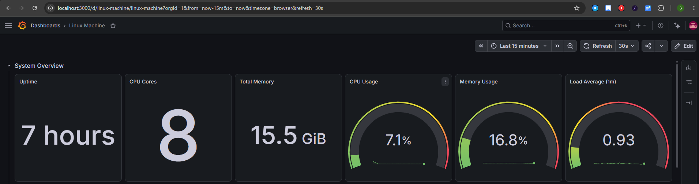
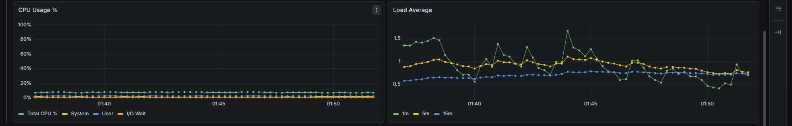
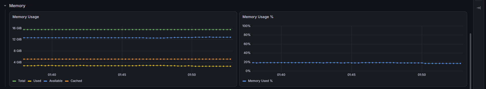
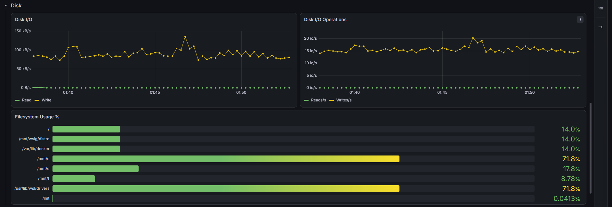
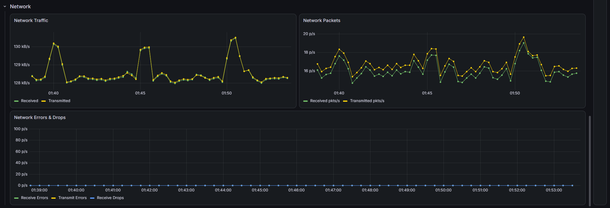

Monitors a Linux machine with Node Exporter, Prometheus, and Grafana. Tracks CPU, memory, disk, and network in real time.

## Stack

| Tool | Version | Purpose |
|---|---|---|
| Node Exporter | 1.8.2 | Collects system metrics |
| Prometheus | 3.13.1 | Scrapes and stores metrics |
| Grafana | latest | Dashboard and visualization |

## Setup

**1. Install Node Exporter**

```bash
wget https://github.com/prometheus/node_exporter/releases/download/v1.8.2/node_exporter-1.8.2.linux-amd64.tar.gz
tar -xzf node_exporter-1.8.2.linux-amd64.tar.gz
sudo cp node_exporter-1.8.2.linux-amd64/node_exporter /usr/local/bin/
```

Create a systemd service:

```bash
sudo tee /etc/systemd/system/node_exporter.service > /dev/null << 'EOF'
[Unit]
Description=Node Exporter
After=network.target

[Service]
User=node_exporter
Group=node_exporter
Type=simple
ExecStart=/usr/local/bin/node_exporter
Restart=on-failure

[Install]
WantedBy=multi-user.target
EOF
```

```bash
sudo useradd --no-create-home --shell /bin/false node_exporter
sudo systemctl daemon-reload
sudo systemctl enable --now node_exporter
```

Verify: `curl http://localhost:9100/metrics`

**2. Configure Prometheus**

Add this scrape job to `prometheus/prometheus.yml`:

```yaml
scrape_configs:
  - job_name: "linux-machine"
    static_configs:
      - targets: ["localhost:9100"]
    relabel_configs:
      - target_label: instance
        replacement: linux-machine
```

Start Prometheus (adjust path to your binary):

```bash
./prometheus --config.file=prometheus/prometheus.yml --storage.tsdb.path=data --web.listen-address=:9095
```

**3. Add datasource in Grafana**

Open Grafana, go to Connections > Data sources > Add, choose Prometheus, set URL to `http://localhost:9095`, and save.

**4. Import the dashboard**

In Grafana go to Dashboards > Import, upload `grafana/dashboards/linux-machine.json`, select the Prometheus datasource, and import.

## Dashboard

Five rows covering the full picture of host health:

| Row | Panels |
|---|---|
| System Overview | Uptime, CPU cores, total memory, CPU %, memory %, load average |
| CPU | Usage by mode (user/system/iowait), load average 1m/5m/15m |
| Memory | Bytes breakdown, usage % over time |
| Disk | I/O read/write bytes, IOPS, filesystem usage per mount |
| Network | Traffic in/out, packets/s, errors and drops |






